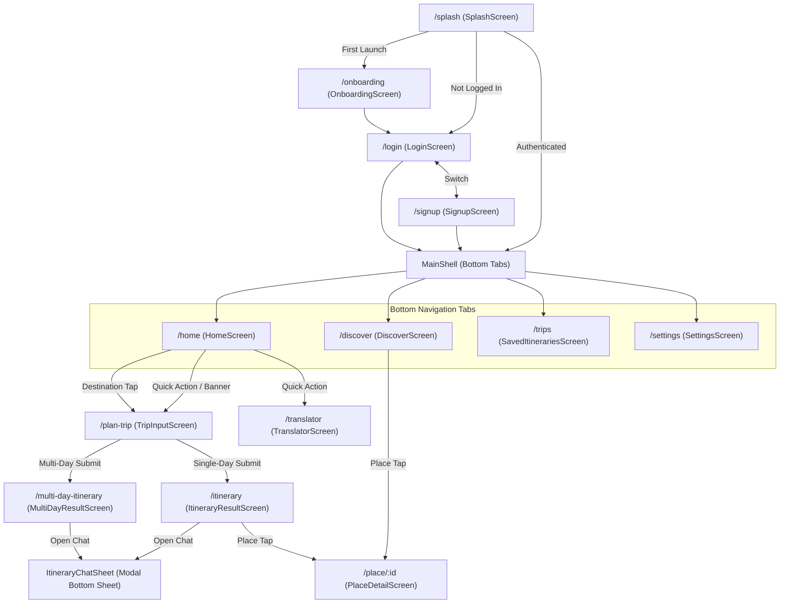

# Ghumify — Complete Project Features & Technical Inventory

> **Document Version:** 1.0.0  
> **Date:** October 30, 2026  
> **Target Audience:** Engineering Team, Product Managers, Technical Auditors  
> **Source Verification:** 100% verified against codebase files in `d:\Projects 2\ghumify_app`

---

## 1. PROJECT OVERVIEW

### 1.1 Purpose & Vision
**Ghumify** (Tagline: *"Always With You"*) is an AI-powered travel companion mobile and web application built specifically for travelers exploring Indian cities. Instead of displaying static top-10 tourist lists, Ghumify curates **intelligent, sequential, time-boxed day-by-day itineraries** tailored to user constraints:
- Available time windows (e.g. 10:00 AM to 6:00 PM)
- Trip duration (single-day or multi-day range)
- User interests (Heritage, Food, Temples, Nature, Markets, Adventure, Photography, Hidden Gems)
- Travel modes (driving, walking, transit) and pacing (relaxed, moderate, fast)
- Demographics and group size (age, travelers count, estimated budget in INR)
- Real-time weather forecasts and context-aware packing recommendations

Beyond planning, Ghumify acts as an all-in-one travel companion providing:
- On-the-ground place discovery (heritage spots, local food stalls, bazaars)
- AI place history written in travel-magazine editorial style
- Dynamic place media galleries fetched via Wikimedia Commons
- A conversational AI travel chatbot that modifies itineraries on the fly
- Emergency and essential nearby services (hospitals, pharmacies, ATMs, police, restrooms, petrol pumps)
- Two-way on-the-ground translator supporting 10 major Indian languages
- Itinerary saving and Firestore persistence

### 1.2 Target Users
1. **Domestic Tourists:** Travelers exploring Indian cities with limited time who want optimized routing without backtracking.
2. **Cultural & Culinary Explorers:** Users seeking curated local food spots (e.g., Sarafa Bazaar, 56 Dukan) rather than generic commercial chains.
3. **Non-Native Regional Speakers:** Tourists traveling across linguistic state borders requiring real-time translation assistance (e.g., Hindi to Tamil/Kannada).
4. **Budget & Family Travelers:** Groups with strict spending limits, specific age requirements, and custom pace needs.

### 1.3 Target Platforms & Support
- **Mobile (Primary):** Android & iOS via Flutter (`lib/`).
- **Web & Desktop:** Flutter Web, Windows (`windows/`), macOS (`macos/`), and Linux (`linux/`) targets scaffolded in the repository.
- **Companion / Prototype:** React Native Expo (SDK 57) mobile app (`App.tsx`, `screens/`, `components/`, and `Demo/`).
- **Backend Service:** Next.js 15 App Router (`backend/`) deployable to Vercel.

---

## 2. TECH STACK

### 2.1 Primary Mobile App (Flutter)
| Layer | Technology | Version | Purpose |
| :--- | :--- | :--- | :--- |
| **Language** | Dart | `^3.13.1` (SDK `>=3.0.0 <4.0.0`) | Primary application logic |
| **Framework** | Flutter | `3.47.1` (Channel stable) | Cross-platform UI toolkit |
| **State Management** | `provider` | `^6.1.2` | Dependency injection & reactive state |
| **Routing** | `go_router` | `^14.1.4` | Declarative routing, auth redirects, deep linking |
| **Authentication** | `firebase_auth`, `google_sign_in` | `^6.5.0`, `^7.2.0` | Email/password & Google OAuth authentication |
| **Database** | `cloud_firestore` | `^6.8.0` | Cloud document database (Users, Saved Trips) |
| **Local Storage** | `shared_preferences` | `^2.2.3` | Settings, first launch flag, chat session persistence |
| **Networking** | `http`, `flutter_dotenv` | `^1.2.1`, `^6.0.1` | REST calls & `.env` configuration |
| **Location** | `geolocator`, `geocoding` | `^14.0.0`, `^5.0.0` | GPS coordinates & reverse geocoding |
| **UI Components** | `google_fonts`, `cached_network_image`, `shimmer` | `^6.1.0`, `^3.3.1`, `^3.0.0` | Typography (Inter, Plus Jakarta Sans), image caching, shimmer effects |
| **External Actions** | `url_launcher` | `^6.2.0` | Opening Google Maps directions & external links |

### 2.2 Secondary / Prototype App (React Native Expo)
| Layer | Technology | Version | Purpose |
| :--- | :--- | :--- | :--- |
| **Framework** | Expo SDK | `~57.0.15` | Rapid mobile development runtime |
| **Core Libraries** | React / React Native | `19.2.3` / `0.86.2` | Mobile UI framework |
| **Navigation** | React Navigation | `^7.3.17` / Bottom Tabs `^7.18.17` | Tab & Stack navigation |
| **Storage** | `@react-native-async-storage/async-storage` | `^3.1.1` | Local device persistence |
| **UI Enhancements** | `expo-linear-gradient`, `expo-image`, `@expo/vector-icons` | `^57.0.1`, `^57.0.3`, `^15.1.1` | Gradients, optimized images, Ionicons |

### 2.3 Backend API Service (Next.js)
| Layer | Technology | Version | Purpose |
| :--- | :--- | :--- | :--- |
| **Framework** | Next.js | `15.x` (App Router) | Serverless API routes |
| **Language** | TypeScript | `~5.x` | Strongly typed server handlers |
| **Hosting** | Vercel (`vercel.json`) | Cloud serverless deployment |

### 2.4 External APIs & Cloud Services
1. **Google Gemini Generative AI:** Multi-model REST client with key rotation across 8 API keys. Models: `gemini-3.7-flash`, `gemini-3.6-flash`, `gemini-3.5-flash`, `gemini-3.5-pro`. Used for itinerary generation, multi-day scheduling, contextual travel chat, editorial place descriptions, and smart packing suggestions.
2. **Google Maps & Places API:** Places text search, nearby search, autocomplete suggestions, distance matrix, and nearby essential services.
3. **OpenWeatherMap API:** Current weather and 5-day weather forecasts by coordinates or city name.
4. **Google Cloud Translation API:** Text translation with memory and Firestore caching across 10 Indian languages.
5. **Wikimedia Commons API:** Free image and media retrieval for tourist spots.
6. **Firebase Cloud Platform:** Authentication, Cloud Firestore document storage.

---

## 3. FULL FEATURE LIST

### 3.1 Authentication & Onboarding
| Feature | Description | Status | Implementation Files |
| :--- | :--- | :--- | :--- |
| **Full-Bleed Splash Screen** | Full-bleed "splash page" visual with edge-matched (#5997C9) zero-flash Android/iOS native background, fade transition, auth state check, first-launch routing. | Completed | `lib/features/auth/screens/splash_screen.dart`, `android/app/src/main/res/drawable/launch_background.xml`, `ios/Runner/Base.lproj/LaunchScreen.storyboard` |
| **Multi-Step Onboarding** | 4-page introduction carousel highlighting discovery, AI planner, weather, and translator. | Completed | `lib/features/onboarding/screens/onboarding_screen.dart` |
| **Email/Password Signup** | Account creation with name, email, password, and automatic Firestore user profile generation. | Completed | `lib/features/auth/screens/signup_screen.dart`, `lib/core/services/auth_service.dart` |
| **Email/Password Login** | Secure authentication with input validation, password visibility toggling, error alerts. | Completed | `lib/features/auth/screens/login_screen.dart`, `lib/core/providers/auth_provider.dart` |
| **Google Sign-In** | One-tap Google OAuth sign-in creating/updating Firestore user profiles. | Completed | `lib/core/services/auth_service.dart` |
| **Session Persistence** | Automatic login restoration using Firebase Auth state stream. | Completed | `lib/core/providers/auth_provider.dart`, `lib/app/routes/app_router.dart` |
| **Sign Out** | Secure user session termination with router redirection. | Completed | `lib/features/settings/screens/settings_screen.dart` |

### 3.2 Home & Dashboard
| Feature | Description | Status | Implementation Files |
| :--- | :--- | :--- | :--- |
| **Dynamic Greeting & Header** | Time-of-day greeting ("Good morning/afternoon/evening") with user avatar and notification badge. | Completed | `lib/features/home/screens/home_screen.dart` |
| **Live Weather Card** | GPS/City-based temperature, weather condition description, humidity, and wind speed. | Completed | `lib/features/home/widgets/weather_card.dart`, `lib/core/services/weather_service.dart` |
| **Search & Filter Bar** | Quick search input that launches the trip planner prefilled with the destination. | Completed | `lib/features/home/screens/home_screen.dart` |
| **Category Filter Chips** | Interactive filter chips (Beach, Mountain, Heritage, Temples, Nature, Food). | Completed | `lib/features/home/screens/home_screen.dart`, `lib/features/home/widgets/category_grid.dart` |
| **Quick Action Shortcuts** | Direct buttons for AI Trip, Translator, Saved Trips, and Explore. | Completed | `lib/features/home/screens/home_screen.dart` |
| **Featured Destinations** | Curated card with badge, rating, pricing, and 1-tap trip planner launch. | Completed | `lib/features/home/screens/home_screen.dart`, `lib/core/widgets/destination_card.dart` |
| **Popular Indian Cities Grid** | 2-column grid featuring Goa, Kerala, Agra, Jaipur with image resolution. | Completed | `lib/features/home/screens/home_screen.dart` |
| **Bottom Navigation Shell** | 4-tab frosted navigation bar: Home, Explore, Trips, Profile. | Completed | `lib/features/home/screens/main_shell.dart` |

### 3.3 AI Trip Planner (Wizard & Itinerary Generation)
| Feature | Description | Status | Implementation Files |
| :--- | :--- | :--- | :--- |
| **4-Step Planning Wizard** | Stepper interface with animated progress bar for configuring trip parameters. | Completed | `lib/features/trip_planner/screens/trip_input_screen.dart` |
| **Smart Destination Autocomplete & GPS** | Debounced (300ms) autocomplete with query caching, Google Places session tokens, OSM Nominatim fallback, Hindi keyword matching, taxonomy badges, query highlighting, and 1-tap GPS location detection. | Completed | `lib/features/trip_planner/screens/trip_input_screen.dart`, `lib/core/services/places_service.dart`, `lib/core/models/place_suggestion_model.dart`, `lib/core/services/location_service.dart` |
| **Single vs Multi-Day Selection** | Interactive date picker supporting single-day or multi-day date ranges. | Completed | `lib/features/trip_planner/screens/trip_input_screen.dart` |
| **Group Size, Age & Budget** | Stepper for travelers count, traveler age input, budget in INR. | Completed | `lib/features/trip_planner/screens/trip_input_screen.dart` |
| **Time & Pace Selection** | Time pickers for start/end time; selection chips for Relaxed, Moderate, Fast pacing. | Completed | `lib/features/trip_planner/screens/trip_input_screen.dart` |
| **Travel Modes** | Driving, Walking, Transit transport mode options. | Completed | `lib/features/trip_planner/screens/trip_input_screen.dart` |
| **12 Interest Tag Selectors** | Selectable chip grid (Famous Places, Heritage, Temples, Local Food, Street Food, Markets, Nature, Culture, Adventure, Hidden Gems, Photography, Family Friendly). | Completed | `lib/features/trip_planner/screens/trip_input_screen.dart`, `lib/core/widgets/selectable_chip.dart` |
| **Food Preference Selector** | 5-option radio button group (Veg, Veg + Egg, Jain, Non-Veg, All) with one-line explanations, colored status dots, and two-way sync with user profile and offline preferences. | Completed | `lib/features/trip_planner/widgets/food_preference_selector.dart`, `lib/core/constants/food_preferences.dart` |
| **Single-Day AI Generation** | Generates sequential time-boxed stops with coordinates, descriptions, travel times, and tips. | Completed | `lib/core/services/gemini_service.dart` |
| **Multi-Day AI Generation** | Distributes attractions across multiple days with daily themes, meal breaks, and sunset spots. | Completed | `lib/core/services/gemini_service.dart` |

### 3.4 Itinerary Presentation & Details
| Feature | Description | Status | Implementation Files |
| :--- | :--- | :--- | :--- |
| **Single-Day Timeline View** | Sequential timeline with stop times, category badges, duration, descriptions, and tips. | Completed | `lib/features/trip_planner/screens/itinerary_result_screen.dart` |
| **Multi-Day Tabbed View** | Tab navigation across days (Day 1, Day 2, etc.) with day themes and daily stops. | Completed | `lib/features/trip_planner/screens/multi_day_result_screen.dart` |
| **Dietary Tag Indicators & Safety** | Food and restaurant stops display visual dietary badges; AI prompts and post-response validation enforce strict dietary compliance (Jain root veg exclusions, Veg egg/meat exclusions, Veg+Egg meat exclusions). | Completed | `lib/core/services/gemini_service.dart`, `lib/core/constants/food_preferences.dart` |
| **Trip Hero & Header** | Dynamic destination imagery, trip duration, rating, and AI trip summary. | Completed | `lib/features/trip_planner/screens/itinerary_result_screen.dart`, `lib/core/utils/image_resolver.dart` |
| **Expense & Budget Breakdown** | Cost estimations split by food, transport, activities, and other expenses with remaining budget tracking. | Completed | `lib/features/trip_planner/screens/itinerary_result_screen.dart`, `lib/features/trip_planner/screens/multi_day_result_screen.dart` |
| **"What to Carry" Checklist** | Smart packing suggestions generated based on city, weather, and visit categories. | Completed | `lib/features/trip_planner/screens/itinerary_result_screen.dart`, `lib/core/services/gemini_service.dart` |
| **Turn-by-Turn Map Directions** | 1-tap launch opening Google Maps navigation for each individual stop. | Completed | `lib/features/trip_planner/screens/itinerary_result_screen.dart` |
| **Place Media Carousel** | Dynamic Wikimedia Commons image carousel embedded for each stop. | Completed | `lib/features/trip_planner/widgets/place_media_gallery.dart`, `lib/core/services/place_media_service.dart` |
| **OpenStreetMap Nearby Safety** | Free OpenStreetMap Overpass integration locating hospitals, clinics, and police stations with 3km–10km auto-widening, 24h caching, coordinate privacy rounding, emergency speed dials (112, 100, 108), Google Maps navigation, direct phone dialing, and offline itinerary persistence. | Completed | `lib/features/trip_planner/widgets/nearby_services_section.dart`, `lib/core/services/places_service.dart`, `lib/core/models/nearby_service_model.dart`, `lib/core/constants/safety_constants.dart` |
| **Save Itinerary to Cloud** | Persists generated itinerary to Firestore under user's saved trips. | Completed | `lib/features/trip_planner/screens/itinerary_result_screen.dart` |

### 3.5 Conversational Chatbot Assistant
| Feature | Description | Status | Implementation Files |
| :--- | :--- | :--- | :--- |
| **Itinerary Chat Bottom Sheet** | Draggable modal bottom sheet with frosted glass styling and full itinerary awareness. | Completed | `lib/features/trip_planner/widgets/itinerary_chat_sheet.dart` |
| **Suggested Prompt Chips** | Quick action chips ("🔄 Replace a place", "➕ Add a food stop", "⏰ I have less time", "😌 Make it more relaxed"). | Completed | `lib/features/trip_planner/widgets/itinerary_chat_sheet.dart` |
| **Contextual Conversational Q&A** | Answers questions about the trip, attractions, food, and timing in natural language. | Completed | `lib/core/services/gemini_service.dart` |
| **Dietary-Aware Food Recommendations** | Chatbot strictly adheres to user's food preference, politely handles dietary conflict questions (e.g. Veg asking for non-veg), and suggests appropriate alternatives. | Completed | `lib/features/trip_planner/widgets/itinerary_chat_sheet.dart`, `lib/core/services/gemini_service.dart` |
| **Dynamic Itinerary Modification** | Re-schedules stops, swaps attractions, and recalculates timing based on user requests. | Completed | `lib/core/services/gemini_service.dart`, `lib/features/trip_planner/widgets/itinerary_chat_sheet.dart` |
| **"Apply Changes" Action** | Interactive button on assistant bubbles to apply AI modifications directly to the live trip. | Completed | `lib/features/trip_planner/widgets/chat_bubble.dart`, `lib/features/trip_planner/widgets/itinerary_chat_sheet.dart` |
| **Anti-JSON Leak Sanitization** | Multi-layer defensive parser that prevents raw JSON dumps and formats summaries. | Completed | `lib/core/services/gemini_service.dart`, `lib/core/models/chat_message_model.dart`, `lib/features/trip_planner/widgets/chat_bubble.dart` |
| **Privacy Protection** | Strips `userId`, internal database IDs, and timestamps before sending itinerary context to the LLM. | Completed | `lib/core/services/gemini_service.dart` |
| **Chat Persistence & Self-Healing** | Saves conversations in `SharedPreferences` and heals old raw JSON upon loading. | Completed | `lib/features/trip_planner/widgets/itinerary_chat_sheet.dart` |

### 3.6 Discovery & Exploration
| Feature | Description | Status | Implementation Files |
| :--- | :--- | :--- | :--- |
| **City-Wide Place Search** | Queries Google Places API for real attractions in any specified Indian city. | Completed | `lib/features/place_discovery/screens/discover_screen.dart`, `lib/core/services/places_service.dart` |
| **Category Filtering** | Filter discovered places by Heritage, Temples, Food, Markets, Nature, Culture. | Completed | `lib/features/place_discovery/screens/discover_screen.dart` |
| **Place Detail View** | Detailed screen with photo gallery, category badge, address, ratings, and opening hours. | Completed | `lib/features/place_detail/screens/place_detail_screen.dart` |
| **AI Editorial History** | AI-generated 80-word magazine-style historical and cultural overview of the place. | Completed | `lib/features/place_detail/screens/place_detail_screen.dart`, `lib/core/services/gemini_service.dart` |
| **Direct Navigation** | Google Maps routing link to navigate directly to the destination. | Completed | `lib/features/place_detail/screens/place_detail_screen.dart` |

### 3.7 Translation & Localization
| Feature | Description | Status | Implementation Files |
| :--- | :--- | :--- | :--- |
| **10-Language Support** | English, Hindi, Gujarati, Marathi, Bengali, Tamil, Telugu, Kannada, Malayalam, Punjabi. | Completed | `lib/core/constants/app_constants.dart`, `lib/features/translator/screens/translator_screen.dart` |
| **Two-Way Text Translator** | Real-time translation between any two supported languages via Google Cloud Translation API. | Completed | `lib/features/translator/screens/translator_screen.dart`, `lib/core/services/translation_service.dart` |
| **Language Swap** | 1-tap button to invert source and target languages. | Completed | `lib/features/translator/screens/translator_screen.dart` |
| **Translation History** | Session history list displaying recent translations. | Completed | `lib/features/translator/screens/translator_screen.dart` |
| **Copy & Share** | 1-tap clipboard copying of translated output. | Completed | `lib/features/translator/screens/translator_screen.dart` |
| **Two-Tier Translation Cache** | In-memory cache + Firestore caching to eliminate redundant translation API costs. | Completed | `lib/core/services/translation_service.dart` |

### 3.8 User Profile & Settings
| Feature | Description | Status | Implementation Files |
| :--- | :--- | :--- | :--- |
| **User Profile Card** | Displays avatar with initials, full name, email address, and membership badge. | Completed | `lib/features/settings/screens/settings_screen.dart` |
| **Saved Trips View** | Dedicated screen streaming all saved itineraries from Firestore with delete and view actions. | Completed | `lib/features/trip_planner/screens/saved_itineraries_screen.dart` |
| **Language Preference** | Language selector saving user preference across sessions. | Completed | `lib/features/settings/screens/settings_screen.dart`, `lib/core/providers/app_settings_provider.dart` |
| **Theme Mode Selector** | Toggle between Light Mode and Dark Mode. | Completed | `lib/features/settings/screens/settings_screen.dart`, `lib/core/providers/app_settings_provider.dart` |
| **App Version & Legal Links** | App version display (`1.0.0`), Privacy Policy, Terms of Service placeholders. | Completed | `lib/features/settings/screens/settings_screen.dart` |

---

## 4. SCREENS / PAGES AND NAVIGATION

### 4.1 Route Table (`lib/app/routes/app_router.dart`)
| Route Path | Screen Class | Access / Guards | Purpose |
| :--- | :--- | :--- | :--- |
| `/splash` | `SplashScreen` | Public | Initial entry, splash animation, auth/first-launch check |
| `/onboarding` | `OnboardingScreen` | First launch | 4-slide onboarding introduction |
| `/login` | `LoginScreen` | Unauthenticated | Email/password & Google login |
| `/signup` | `SignupScreen` | Unauthenticated | Account registration |
| `/home` | `HomeScreen` | Shell Tab 0 (Auth required) | Main dashboard: weather, categories, destinations |
| `/discover` | `DiscoverScreen` | Shell Tab 1 (Auth required) | Search and browse places in cities |
| `/trips` | `SavedItinerariesScreen` | Shell Tab 2 (Auth required) | User's saved Firestore itineraries |
| `/settings` | `SettingsScreen` | Shell Tab 3 (Auth required) | Profile info, theme, language, sign out |
| `/translator` | `TranslatorScreen` | Standalone (Auth required) | Two-way tourist translator |
| `/plan-trip` | `TripInputScreen` | Standalone (Auth required) | 4-step AI trip planning wizard |
| `/itinerary` | `ItineraryResultScreen` | Standalone (Auth required) | Single-day AI itinerary result & timeline |
| `/multi-day-itinerary` | `MultiDayResultScreen` | Standalone (Auth required) | Multi-day AI itinerary result & day tabs |
| `/place/:id` | `PlaceDetailScreen` | Standalone (Auth required) | Detailed place overview, media & AI history |
| `/saved-itineraries` | `SavedItinerariesScreen` | Standalone (Auth required) | Direct navigation link to saved trips |

### 4.2 Navigation Hierarchy Diagram


---

## 5. USER FLOWS

### Flow 1: New User First Launch & Registration
1. App launches on `SplashScreen` (`/splash`).
2. `AppSettingsProvider.isFirstLaunch` detects first run and navigates to `/onboarding`.
3. User swipes through 4 slides highlighting AI planning, weather, discovery, and translator.
4. User taps "Get Started", triggering `setFirstLaunchDone()` and navigating to `/signup`.
5. User enters Full Name, Email, Password, and selects initial interests.
6. `AuthProvider.signUp()` creates Firebase Auth user and initial Firestore document.
7. Router automatically redirects user to `/home`.

### Flow 2: Planning a Single-Day Trip
1. From `/home`, user taps "AI Trip" or the search input, navigating to `/plan-trip`.
2. **Step 0 (Destination):** User enters city (e.g., "Indore") or taps "Current Location" (GPS detection). User selects trip dates (same-day).
3. **Step 1 (Schedule & Pace):** User sets daily hours (10:00 AM to 6:00 PM) and selects "Moderate" pace.
4. **Step 2 (Preferences):** User selects "Driving" mode and toggles interests ("Famous Places", "Local Food", "Markets").
5. **Step 3 (Review):** User verifies summary card and taps "Generate AI Itinerary".
6. User is redirected to `/itinerary`. Loading animation displays dynamic progress messages.
7. `GeminiService.generateItinerary` executes REST API call using model fallback and key rotation.
8. Single-day itinerary renders with timeline stops, weather widget, "What to Carry" checklist, expense breakdown, and nearby services.
9. User taps "Save Itinerary" to store trip permanently in Firestore.

### Flow 3: Conversational Itinerary Modification
1. From `/itinerary`, user taps the floating AI Chat icon, opening `ItineraryChatSheet`.
2. Chat loads prior session messages from `SharedPreferences` (auto-healing any old raw JSON).
3. User selects chip "➕ Add a food stop" or types "Replace Rock Garden with a lake".
4. User message is appended and passed to `GeminiService.chatAboutItinerary`.
5. Sanitized itinerary context (without user IDs or private keys) is sent to Gemini.
6. Gemini returns a response with two decoupled parts:
   - `chatMessage`: Friendly conversational explanation with bullet points.
   - `updatedItinerary`: Background modified itinerary map.
7. `ChatBubble` displays the friendly explanation and renders an "Apply Changes to Itinerary" button.
8. User taps "Apply Changes to Itinerary". The parent screen updates its state and displays a confirmation SnackBar.

### Flow 4: Translating on the Ground
1. User taps "Translate" quick action on the home screen, opening `/translator`.
2. User chooses Source Language (e.g. English) and Target Language (e.g. Hindi).
3. User types conversational phrase: *"How much does this handicraft cost?"*.
4. User taps "Translate". `TranslationService` checks in-memory cache, then Firestore cache, then calls Google Translate API.
5. Translated text (*"इस हस्तशिल्प की कीमत कितनी है?"*) appears with 1-tap Copy action.
6. Entry is automatically saved into local session history list.

---

## 6. ARCHITECTURE AND FOLDER STRUCTURE

### 6.1 Repository File Tree
```
d:\Projects 2\ghumify_app\
├── .env                                  # API keys & environment secrets
├── AGENTS.md                             # AI Agent instructions & Expo 57 notes
├── CLAUDE.md                             # Agent reference pointer
├── LICENSE                               # MIT License
├── README.md                             # Flutter starter readme
├── app_presentation_details.md           # Simple presentation notes
├── handoff_report.md                     # Previous handoff report
├── project.md                            # Comprehensive project specification
├── pubspec.yaml                          # Flutter package dependencies & assets
├── task.md                               # Issue and bug tracking log
├── PROJECT_FEATURES.md                   # Complete features & technical inventory
│
├── android/                              # Native Android platform project
├── ios/                                  # Native iOS platform project
├── web/                                  # Flutter Web platform project
├── windows/                              # Windows desktop platform project
├── macos/                                # macOS desktop platform project
├── linux/                                # Linux desktop platform project
│
├── assets/
│   └── images/                           # Local raster assets (logo.png, jaipur.jpeg, etc.)
│
├── lib/                                  # PRIMARY FLUTTER APP CODE
│   ├── main.dart                         # Main Flutter entry point
│   ├── firebase_options.dart             # FlutterFire auto-generated platform options
│   │
│   ├── app/                              # Core application layer
│   │   ├── routes/
│   │   │   └── app_router.dart           # GoRouter declarative navigation & auth guard
│   │   └── theme/
│   │       ├── app_colors.dart           # Color definitions & gradients
│   │       ├── app_theme.dart            # ThemeData (Light/Dark), typography, buttons
│   │       └── app_tokens.dart           # Spacing, radius, elevation design tokens
│   │
│   ├── core/                             # Core cross-feature utilities
│   │   ├── constants/
│   │   │   ├── api_keys.dart             # .env readers with fallback getters
│   │   │   └── app_constants.dart        # Categories, languages, collections
│   │   ├── models/
│   │   │   ├── chat_message_model.dart   # Chat messages & sessions with auto-sanitization
│   │   │   ├── food_spot_model.dart      # Famous food stalls & culinary spots
│   │   │   ├── itinerary_model.dart      # Single-day itineraries & stops
│   │   │   ├── market_model.dart         # Local bazaars & markets
│   │   │   ├── multi_day_itinerary_model.dart # Multi-day itineraries & day models
│   │   │   ├── nearby_service_model.dart # Hospitals, ATMs, pharmacies, police
│   │   │   ├── place_media_model.dart    # Wikimedia Commons media wrapper
│   │   │   ├── place_model.dart          # Tourist places & attractions
│   │   │   ├── user_model.dart           # User profile & saved trips
│   │   │   └── weather_model.dart        # Current weather & forecast items
│   │   ├── providers/
│   │   │   ├── app_settings_provider.dart# Theme mode, language & first launch state
│   │   │   └── auth_provider.dart        # Authentication & user profile state
│   │   ├── services/
│   │   │   ├── api_service.dart          # HTTP bridge to Next.js route optimizer
│   │   │   ├── auth_service.dart         # Firebase Auth & Google Sign-In wrapper
│   │   │   ├── gemini_rest_client.dart   # REST client with key rotation & fallbacks
│   │   │   ├── gemini_service.dart       # Gemini itinerary, chat, history & packing
│   │   │   ├── location_service.dart     # GPS coordinates & reverse geocoding
│   │   │   ├── place_media_service.dart  # Wikimedia Commons image search
│   │   │   ├── places_service.dart       # Google Places API client
│   │   │   ├── translation_service.dart  # Google Translate with 2-tier caching
│   │   │   └── weather_service.dart      # OpenWeatherMap current & forecast
│   │   ├── utils/
│   │   │   └── image_resolver.dart       # City hero images & asset/network resolver
│   │   └── widgets/                      # Shared core UI widgets
│   │       ├── app_image.dart            # Cached network image with shimmer fallback
│   │       ├── destination_card.dart     # Grid/horizontal card for destinations
│   │       ├── premium_background.dart   # Glassmorphism ambient glow background
│   │       ├── premium_card.dart         # Frosted glass card container
│   │       ├── section_header.dart       # Title row with "See all" action
│   │       └── selectable_chip.dart      # Interactive chip widget
│   │
│   ├── features/                         # Feature-driven UI modules
│   │   ├── auth/screens/                 # LoginScreen, SignupScreen, SplashScreen
│   │   ├── home/screens/                 # HomeScreen, MainShell
│   │   ├── home/widgets/                 # WeatherCard, CategoryGrid, PopularCities
│   │   ├── onboarding/screens/           # OnboardingScreen (4 slides)
│   │   ├── place_detail/screens/         # PlaceDetailScreen
│   │   ├── place_discovery/screens/      # DiscoverScreen
│   │   ├── settings/screens/             # SettingsScreen
│   │   ├── translator/screens/           # TranslatorScreen
│   │   ├── trip_planner/screens/         # TripInputScreen, ItineraryResultScreen, MultiDayResultScreen, SavedItinerariesScreen
│   │   ├── trip_planner/widgets/         # ChatBubble, ItineraryChatSheet, NearbyServicesSection, PlaceMediaGallery
│   │   ├── weather/widgets/              # (Empty directory - widgets in home & itinerary)
│   │   └── what_to_carry/widgets/        # (Empty directory - widgets in itinerary screens)
│   │
│   └── widgets/                          # Additional legacy/shared widgets
│       ├── action_grid.dart              # Home quick action grid
│       ├── destination_hero.dart         # Hero image header
│       ├── glass_card.dart               # Backdrop filter glass card
│       └── image_carousel.dart           # Swipeable image slider
│
├── backend/                              # NEXT.JS SERVERLESS BACKEND
│   ├── src/app/api/
│   │   ├── distance/route.ts             # Google Distance Matrix API handler
│   │   └── itinerary/plan/route.ts       # Nearest Neighbor TSP route optimizer
│   ├── package.json                      # Next.js dependencies
│   └── tsconfig.json                     # TypeScript compiler configuration
│
├── screens/ & components/                # SECONDARY REACT NATIVE EXPO APP
│   ├── App.tsx                           # Expo Root Component & React Navigation
│   ├── screens/                          # HomeScreen, PlanResultScreen, ExploreScreen, PlaceDetailScreen, TranslateScreen, StaysScreen, SettingsScreen
│   ├── components/                       # Chip, GradientView, Loading, PlaceCard, SectionHeader
│   └── package.json                      # Expo dependencies
│
├── Demo/                                 # Duplicate standalone copy of Expo app
├── designpowers/                         # Design agent team specification
└── test/                                 # Automated test suite
    ├── chat_sanitization_test.dart       # 6 unit tests for chat sanitization & security
    └── widget_test.dart                  # Default counter test (fails - needs update)
```

### 6.2 Data Flow Architecture
```mermaid
flowchart TD
    UI[Flutter UI Layer] <--> Providers[Provider State Layer]
    Providers <--> Services[Core Services Layer]
    Services <--> Firebase[Firebase Auth / Cloud Firestore]
    Services <--> Gemini[Google Gemini REST API (8 Keys)]
    Services <--> GoogleMaps[Google Maps & Places API]
    Services <--> OpenWeather[OpenWeatherMap API]
    Services <--> Wikimedia[Wikimedia Commons API]
    Services <--> NextBackend[Next.js Optimization API]
```

---

## 7. DATA MODELS AND DATABASE

### 7.1 Firestore Collections
1. **`users` (`AppConstants.usersCollection`):** User accounts and personalization settings.
2. **`itineraries` (`AppConstants.itinerariesCollection`):** Generated travel plans saved by users.
3. **`places` (`AppConstants.placesCollection`):** Curated tourist attractions and heritage monuments.
4. **`foodSpots` (`AppConstants.foodSpotsCollection`):** Famous culinary establishments and street food hubs.
5. **`markets` (`AppConstants.marketsCollection`):** Local shopping bazaars and night markets.
6. **`translations` (`AppConstants.translationsCollection`):** Cached phrase translations to avoid re-querying Google Translate.
7. **`events` (`AppConstants.eventsCollection`):** Cultural and religious events (e.g. Maha Aarti) tied to places.
8. **`audioGuides` (`AppConstants.audioGuidesCollection`):** Premium tier audio guide metadata.

### 7.2 Entity Specifications

#### 7.2.1 `UserModel` (`lib/core/models/user_model.dart`)
| Field | Type | Description |
| :--- | :--- | :--- |
| `uid` | `String` | Firebase Auth UID (document key) |
| `name` | `String` | Full name of the user |
| `email` | `String` | User email address |
| `photoUrl` | `String?` | Optional avatar image URL |
| `preferredLanguage` | `String` | Two-letter ISO language code (default `'en'`) |
| `interests` | `List<String>` | Selected travel tags |
| `savedTripIds` | `List<String>` | List of saved itinerary document IDs |
| `isPremium` | `bool` | Premium subscriber status (default `false`) |
| `createdAt` | `DateTime` | Account creation timestamp |
| `updatedAt` | `DateTime` | Profile last update timestamp |

#### 7.2.2 `ItineraryModel` & `ItineraryStop` (`lib/core/models/itinerary_model.dart`)
| Field | Type | Description |
| :--- | :--- | :--- |
| `id` | `String` | Unique trip identifier |
| `userId` | `String` | Owner user identifier |
| `city` | `String` | Destination city |
| `date` | `String` | Date string (e.g. `"2026-10-30"`) |
| `startTime` / `endTime` | `String` | Trip time window (e.g. `"10:00"`, `"18:00"`) |
| `totalDurationMinutes` | `int` | Total minutes spanned |
| `interests` | `List<String>` | Trip interest tags |
| `travelMode` | `String` | `"driving"`, `"walking"`, or `"transit"` |
| `pace` | `String` | `"relaxed"`, `"moderate"`, or `"fast"` |
| `stops` | `List<ItineraryStop>` | Sequential list of stops |
| `weatherSummary` | `String?` | Text weather conditions |
| `whatToCarry` | `List<String>` | Smart packing suggestions |
| `aiSummary` | `String?` | Editorial trip overview |
| `isSaved` | `bool` | Persistence flag |
| `dayNumber` | `int` | Day index in multi-day trip |
| `age`, `travelers`, `budget` | `int?` | User demographic and budget parameters |
| `estimatedTotalCost` | `int?` | Calculated total trip expense |
| `remainingBudget` | `int?` | Unspent budget |
| `expenseSummary` | `Map<String, dynamic>?` | Breakdown by food, transport, activities, other |

*Each `ItineraryStop` contains: `name`, `type` (place/food/market/travel/break), `startTime`, `endTime`, `durationMinutes`, `latitude`, `longitude`, `description`, `tips` (list of strings), `estimatedCost`, `travelMode`, `travelMinutes`.*

#### 7.2.3 `MultiDayItineraryModel` (`lib/core/models/multi_day_itinerary_model.dart`)
Includes all parameters of `ItineraryModel` plus: `startDate`, `endDate`, `numberOfDays`, `dailyStartTime`, `dailyEndTime`, `days` (list of `ItineraryModel` day objects), `overallSummary`, `overallExpenseSummary`.

#### 7.2.4 `ChatMessageModel` & `ChatSessionModel` (`lib/core/models/chat_message_model.dart`)
| Field | Type | Description |
| :--- | :--- | :--- |
| `id` | `String` | Message unique identifier |
| `role` | `String` | `'user'` or `'assistant'` |
| `content` | `String` | Sanitized conversational text (auto-sanitizes raw JSON) |
| `timestamp` | `DateTime` | Message timestamp |
| `updatedItinerary` | `Map<String, dynamic>?` | Modified itinerary object payload (if changes suggested) |

*`ChatSessionModel` encapsulates: `id`, `itineraryId`, `messages` (`List<ChatMessageModel>`), `createdAt`, `updatedAt`.*

#### 7.2.5 `PlaceModel` (`lib/core/models/place_model.dart`)
Fields: `id`, `name`, `city`, `state`, `category`, `description`, `history`, `latitude`, `longitude`, `address`, `openingHours` (Map), `photoUrls`, `thumbnailUrl`, `avgVisitDurationMinutes`, `rating`, `reviewCount`, `entryFee`, `tags`, `nearbyPlaceIds`, `googlePlaceId`, `isHiddenGem`, `specialNote`.

#### 7.2.6 `FoodSpotModel` (`lib/core/models/food_spot_model.dart`)
Fields: `id`, `name`, `city`, `specialty`, `description`, `latitude`, `longitude`, `address`, `photoUrls`, `thumbnailUrl`, `rating`, `reviewCount`, `priceRange`, `openingHours`, `tags`, `isFamous`, `googlePlaceId`.

#### 7.2.7 `MarketModel` (`lib/core/models/market_model.dart`)
Fields: `id`, `name`, `city`, `specialty`, `description`, `latitude`, `longitude`, `address`, `photoUrls`, `thumbnailUrl`, `rating`, `reviewCount`, `openingHours`, `tags`, `isFamous`, `bestTimeToVisit`.

#### 7.2.8 `NearbyServiceModel` (`lib/core/models/nearby_service_model.dart`)
Fields: `id`, `name`, `type` (hospital, pharmacy, atm, police, restroom, gas), `vicinity`, `rating`, `userRatingsTotal`, `isOpenNow`, `latitude`, `longitude`.

---

## 8. APIS, SERVICES, AND INTEGRATIONS

### 8.1 Internal Service Classes (`lib/core/services/`)
1. **`AuthService` (`auth_service.dart`):** Wraps Firebase Authentication and Google Sign-In. Manages user sign-up, sign-in, sign-out, password resets, and Firestore user profile documents in `users/`.
2. **`GeminiRestClient` (`gemini_rest_client.dart`):** Low-level REST client communicating with Google Gemini API endpoints (`generativelanguage.googleapis.com`). Features:
   - Automated model fallback (`gemini-3.7-flash` → `gemini-3.6-flash` → `gemini-3.5-flash` → `gemini-3.5-pro`).
   - Round-robin key rotation across up to 8 configured API keys.
   - Dedicated temperature and token limits per task type (`complexPlanning`, `fastModification`, `chat`, `placeInfo`, `translation`).
3. **`GeminiService` (`gemini_service.dart`):** High-level AI business logic:
   - `generateItinerary`: Prompt builder and response parser for single-day trips.
   - `generateMultiDayItinerary`: Multi-day itinerary generator with daily geographic grouping.
   - `chatAboutItinerary`: Contextual chat engine with prompt sanitization, JSON extraction, and safety fallback summaries.
   - `generatePlaceHistory`: Generates 80-word historical descriptions.
   - `generateCarrySuggestions`: Generates 5 context-aware packing tips based on city, weather, and time of day.
4. **`PlacesService` (`places_service.dart`):** Google Places API client:
   - `searchPlaces`: Text search for city attractions.
   - `getPlaceDetails`: Fetch place photos, reviews, opening hours, formatted address.
   - `getCitySuggestions`: Autocomplete suggestions for Indian cities.
   - `getNearbyServices`: Location-based discovery of hospitals, ATMs, pharmacies, police stations, restrooms, and petrol stations.
5. **`WeatherService` (`weather_service.dart`):** OpenWeatherMap API client:
   - `getCurrentWeather`: Fetches current temperature, condition, humidity, wind, and weather icons.
   - `getForecast`: Fetches 5-day / 3-hour forecasts with rain/heat warnings.
6. **`TranslationService` (`translation_service.dart`):** Google Cloud Translation API client:
   - Translates text across 10 Indian languages.
   - Implements two-tier caching: Tier 1 in-memory map; Tier 2 Cloud Firestore `translations/` collection.
7. **`LocationService` (`location_service.dart`):** Wraps `geolocator` and `geocoding` plugins. Handles runtime location permissions, GPS coordinate retrieval, and reverse geocoding to determine current city and state.
8. **`PlaceMediaService` (`place_media_service.dart`):** Free Wikimedia Commons API integration fetching high-resolution Creative Commons photos for attractions.
9. **`ApiService` (`api_service.dart`):** HTTP client connecting the mobile client to the Next.js optimization backend at `/api/itinerary/plan`.

### 8.2 Backend Serverless API (`backend/src/app/api/`)
1. **`/api/distance` (`backend/src/app/api/distance/route.ts`):** Accepts origin and destination coordinates, queries Google Maps Distance Matrix API, and returns formatted distance and duration.
2. **`/api/itinerary/plan` (`backend/src/app/api/itinerary/plan/route.ts`):** Accepts origin and a list of destinations. Computes the complete distance matrix and runs a Nearest Neighbor algorithm to return the geographically optimal visiting order, avoiding backtracking.

---

## 9. AI / CHATBOT SPECIFICATIONS

### 9.1 Multi-Key Failover Architecture
The Gemini AI engine reads up to 8 API keys (`GEMINI_API_KEY_1` to `GEMINI_API_KEY_8`) from `.env`. If a key encounters rate limits (HTTP 429) or quota errors, `GeminiRestClient` automatically advances to the next key. If a model encounters a 404/unsupported error, it falls back down the model chain (`3.7-flash` → `3.6-flash` → `3.5-flash` → `3.5-pro`).

### 9.2 Task Model Configurations
| Task Type | Primary Model | Temperature | Max Tokens |
| :--- | :--- | :--- | :--- |
| `complexPlanning` | `gemini-3.7-flash` | `0.6` | 16,384 |
| `fastModification` | `gemini-3.7-flash` | `0.5` | 8,192 |
| `chat` | `gemini-3.7-flash` | `0.8` | 4,096 |
| `generalQuestion` | `gemini-3.7-flash` | `0.7` | 2,048 |
| `placeInfo` | `gemini-3.7-flash` | `0.8` | 1,024 |
| `translation` | `gemini-3.7-flash` | `0.3` | 2,048 |

### 9.3 Prompt Engineering & Privacy Protection
- **Privacy Sanitizer (`_sanitizeItineraryForPrompt`):** Strips `userId`, internal document `id`, `createdAt`, `isSaved`, and internal `placeId` references before encoding the itinerary into the prompt context.
- **Role Decoupling:** Modifying prompts instructs Gemini to produce two decoupled fields:
  ```json
  {
    "chatMessage": "Friendly conversational summary of changes in natural language with bullet points",
    "updatedItinerary": { ...structured modified itinerary... }
  }
  ```
- **Anti-Leak Safety Net (`ChatMessageModel.sanitizeContent`):**
  - Defensively inspects all assistant outputs.
  - If output contains raw JSON or structured syntax, parses the stops and formats a clean human-readable itinerary summary with bullet points.
  - Never displays raw braces, quotes, or internal keys to the user.

---

## 10. CONFIGURATION AND SETUP

### 10.1 Environment Variables (`.env`)
The application requires the following environment variables (defined in `.env` and loaded via `flutter_dotenv`):
- `GOOGLE_MAPS_API_KEY`: API key for Google Maps SDK, Places API, and Distance Matrix API.
- `OPENWEATHERMAP_API_KEY`: API key for OpenWeatherMap current and forecast endpoints.
- `GOOGLE_TRANSLATE_API_KEY`: API key for Google Cloud Translation API.
- `GEMINI_API_KEY_1` through `GEMINI_API_KEY_8`: Up to 8 Google Gemini API keys for load balancing and rate-limit rotation.

### 10.2 Build and Run Commands
- **Flutter Mobile App:**
  ```bash
  # Install dependencies
  flutter pub get

  # Run on connected device (Android/iOS/Windows/Chrome)
  flutter run

  # Run static analysis
  flutter analyze

  # Run automated test suite
  flutter test test/chat_sanitization_test.dart
  ```
- **Next.js Backend Server:**
  ```bash
  cd backend
  npm install
  npm run dev
  ```
- **React Native Expo Prototype:**
  ```bash
  npm install
  npx expo start
  ```

---

## 11. PROGRESS SUMMARY

### 11.1 What is Completed
- Full authentication cycle (Email/Password, Google OAuth, Session restore, Logout).
- 4-step trip planning wizard supporting single-day and multi-day date ranges.
- Dual AI generation engine (single-day and multi-day itineraries) powered by Gemini REST client with 8-key rotation.
- Real-time weather integration with OpenWeatherMap.
- GPS location detection and reverse geocoding.
- Google Places API integration for city search and place details with smart multi-source autocomplete (query caching, session tokens, OpenStreetMap fallback, Hindi transliteration).
- Nearby essential emergency services discovery.
- Wikimedia Commons dynamic image fetching.
- Full two-way text translation across 10 Indian languages with Firestore caching.
- Itinerary saving and user profile synchronization in Cloud Firestore.
- Decoupled conversational itinerary chatbot with automated anti-JSON sanitization and local session persistence.
- Next.js route optimizer backend with distance matrix calculations.

### 11.2 What is In Progress / Partially Done
- **UI Localization (l10n):** Supported languages are defined in constants and translator works, but `lib/l10n/` is currently empty. Hardcoded UI strings in screens are primarily in English.
- **Audio Guides Feature:** Documented as a premium monetization tier in `project.md`, collection constant exists (`audioGuides`), but audio playback or generation engine is not yet built.
- **Firestore Security Rules:** Collections and schema are designed, but client access currently relies on client-side authentication checks without deployed server-side security rules (`firestore.indexes.json` present).

### 11.3 What is Not Started / Deferred
- International language expansions outside Indian regional languages.
- Social sharing of itineraries between users.
- Live traffic transit tracking refinements.

---

## 12. KNOWN ISSUES AND GAPS

1. **Dual Codebase Inconsistency:**
   - The root repository contains both a full Flutter application (`lib/`, `pubspec.yaml`) and a duplicate React Native Expo application (`App.tsx`, `package.json`, `screens/`, `components/`).
   - The React Native files in root are identical copies of `Demo/`. This creates developer confusion regarding the primary build target.
2. **Default Template Counter Test Failure:**
   - `test/widget_test.dart` contains the stock Flutter counter test (`find.text('0')`), which fails because `GhumifyApp` is a complex travel app with routers and providers rather than a counter app.
3. **Empty Feature Widget Folders:**
   - Directories `lib/features/weather/widgets/` and `lib/features/what_to_carry/widgets/` are empty. Their corresponding widgets were implemented inline or inside `features/home/` and `features/trip_planner/`.
4. **Deprecated Flutter API Calls (`withOpacity`):**
   - Several UI widgets utilize `.withOpacity(...)` which Flutter 3.47+ flags as deprecated in favor of `.withValues()`.
5. **Hardcoded Android Emulator IP in ApiService:**
   - `ApiService._baseUrl` is hardcoded to `http://10.0.2.2:3000/api` for Android emulator access. In production, this should be configurable via environment variable for Vercel deployment.
6. **Print Statements in Production Services:**
   - `place_media_service.dart` and `test_service.dart` contain raw `print(...)` statements instead of a structured logging framework.

---

## 13. SUGGESTED IMPROVEMENTS

1. **Root Directory Cleanup:**
   - Move or archive the React Native Expo files (`App.tsx`, `screens/`, `components/`, `package.json`) into `Demo/` or a dedicated prototype folder so the root repository strictly represents the primary Flutter application.
2. **Comprehensive UI Localization (arb/l10n):**
   - Populate `lib/l10n` with Flutter `.arb` localization files for the 10 supported Indian languages so all app labels dynamically translate when the user changes their language setting.
3. **Audio Guide Integration:**
   - Implement text-to-speech (TTS) or pre-recorded audio guide playback for heritage monuments using `audioplayers` or `just_audio` to fulfill the premium tier outlined in `project.md`.
4. **Offline Map & Itinerary Caching:**
   - Cache downloaded trip stops, directions, and emergency services into SQLite (`sqflite`) so travelers in remote areas without cellular connectivity can access their itinerary.
5. **Real-time Push Notifications:**
   - Integrate Firebase Cloud Messaging (FCM) to deliver timely reminders (e.g. "Time to head to your next stop at Rajwada Palace", "Rain expected in 1 hour").
6. **Itinerary Export & Sharing:**
   - Add PDF export and WhatsApp trip sharing so traveling companions can review the day's itinerary.
